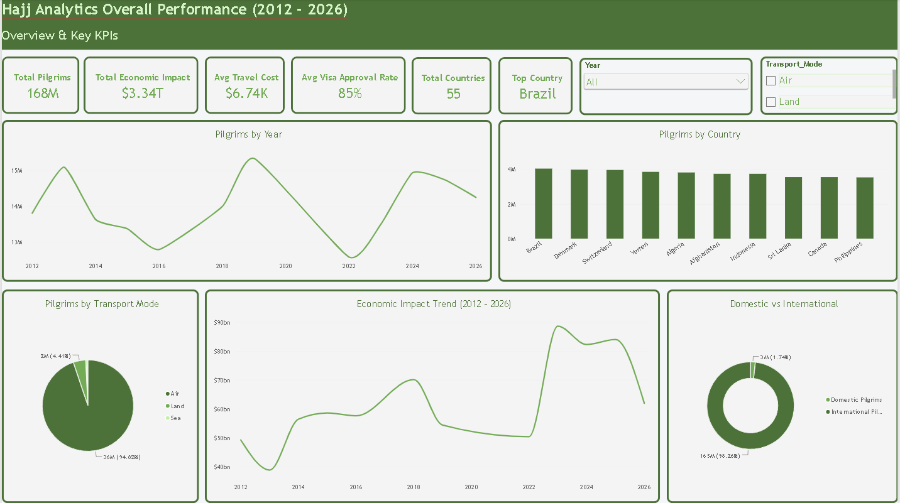
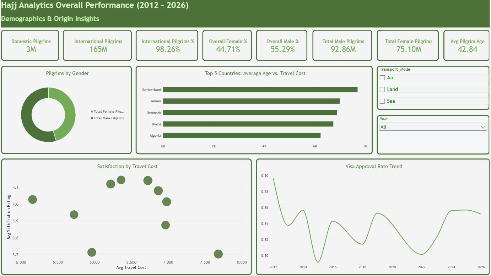

# 🕋 Hajj Pilgrimage Analytics (2012–2026) | End-to-End Data Pipeline

An **End-to-End Data Analytics & Engineering Project** analyzing global Hajj pilgrimage data across 55 countries spanning 2012 to 2026. This project covers the full data lifecycle: **SQL Data Engineering & Transformation**, **Data Modeling**, **DAX Measure Architecture**, and **Executive UI/UX Power BI Dashboard Design**.

---

## 📌 Executive Summary
* **Dataset Scope:** 55 Origin Countries | Timeline: 2012 – 2026 | Total Pilgrims Evaluated: **~168+ Million**.
* **Objective:** Provide actionable insights for decision-makers regarding pilgrim demographics, transportation distribution, economic impact, travel costs, visa approval rates, and satisfaction metrics.

---

## 📁 Repository Structure

```text
Hajj-Analytics-End-to-End-PowerBI/
│
├── 📁 Data/                   # Raw & Processed Datasets
├── 📁 SQL/                    # SQL Transformation Scripts & KPI Query Exports
├── 📁 PowerBI/                # Interactive Power BI Dashboard File (.pbix)
├── 📁 Screenshots/            # Dashboard Visual Previews
└── README.md                  # Project Documentation
```
---

## 🛠️ Data Pipeline Architecture

### 1️⃣ SQL Data Engineering & Pipeline (`MySQL Workbench`)
* **Encoding & Schema Setup:** Created the `hajj` schema and resolved character encoding issues (`UTF-8`) by standardizing text fields to English (`Year`, `Arrival_Method`, `Share`).
* **Path & Error Optimization:** Handled long file path errors and modularized tables into relational entities (`hajj_data` & `transport_distribution`).
* **Data Joining & Calculation:**
  * Applied `INNER JOIN` operations matching `Year` primary keys.
  * Filtered scope specifically for `Pilgrimage_Type = 'Hajj'` across 2012–2026.
  * Computed individual mode estimates using:
    $$\text{Estimated\_Pilgrims\_Count} = \text{ROUND}(\text{Total\_Pilgrims} \times \text{Share})$$
* **SQL Views (`vw_hajj_final_analysis`):** Constructed analytical database views to serve as a reliable downstream source for BI tool connection.

### 2️⃣ Data Modeling & Advanced DAX Engineering (`Power BI`)
* **Star Schema Design:** Constructed an independent `Dim_Calendar` table linked via 1-to-Many relationships for seamless time intelligence analysis.
* **Core DAX Measures Implemented:**
  * **Executive KPIs:** `Total Pilgrims`, `Total Economic Impact`, `Avg Travel Cost`, `Avg Visa Approval Rate`, `Avg Satisfaction`.
  * **Demographic Breakdown:** `Total Male Pilgrims`, `Total Female Pilgrims`, `Overall Male %`, `Overall Female %`.
  * **Segmentation:** `Domestic Pilgrims` (Saudi Arabia) vs. `International Pilgrims`.
  * **Time Intelligence:** Year-over-Year (YoY) Growth tracking using `SAMEPERIODLASTYEAR`.
  * **Dynamic UI Control:** Dynamic visual title measures reacting to user slicer selections.

---

## 🎨 Dashboard UI/UX Design

Built with an executive dark-green visual identity inspired by the **Saudi Flag (`#006C35`)**, paired with soft neutral backgrounds (`#F4F6F7`) and rounded visual cards.

### 📄 Page 1: Overview & Key KPIs
* High-level Executive KPI Cards.
* Multi-year historical pilgrim trend (2012–2026).
* Donut chart breakdown by mode of travel (Air, Land, Sea).
* Ranked bar chart of Top 10 pilgrim-origin nations.

### 📄 Page 2: Demographics & Origin Insights
* Domestic vs. International split metrics.
* Gender ratio and age profile distribution.
* Country-level comparison: Age Profile vs. Travel Costs.
* Correlation analysis (Scatter Plot): Travel Cost vs. Satisfaction Rating.

---

## 📸 Dashboard Preview

| Executive Overview | Demographics & Insights |
|---|---|
|  |  |

---

## 🚀 How to Run

1. **Clone the Repository:**
   ```bash
   git clone https://github.com/Youssefmohamed18/Hajj-Analytics.git

   ```
   ---
   Setup Database:
Import and run SQL/hajj_final_data.sql inside MySQL Workbench.

Open Power BI Dashboard:
Open PowerBI/Hajj.pbix using Power BI Desktop.
